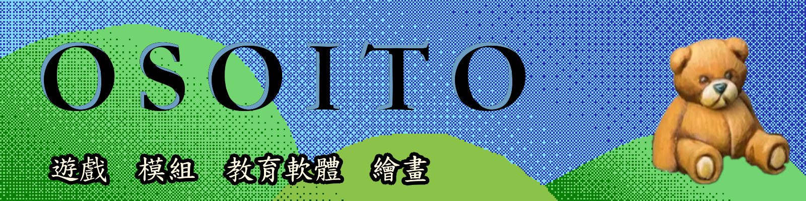
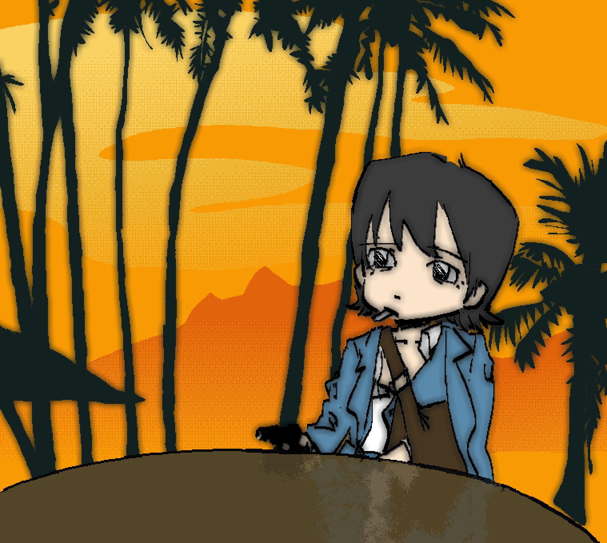
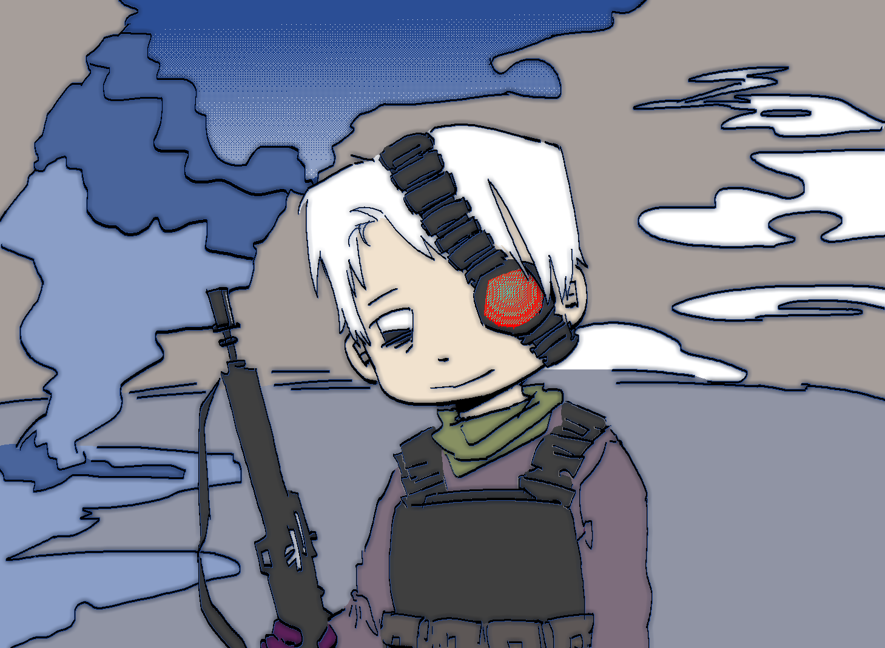
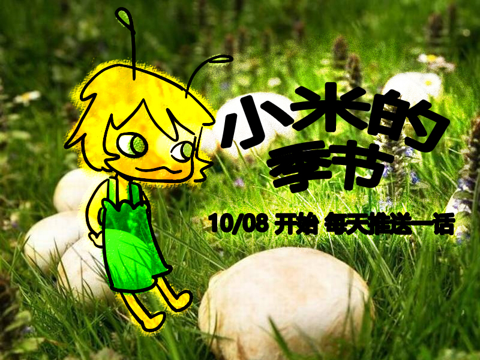
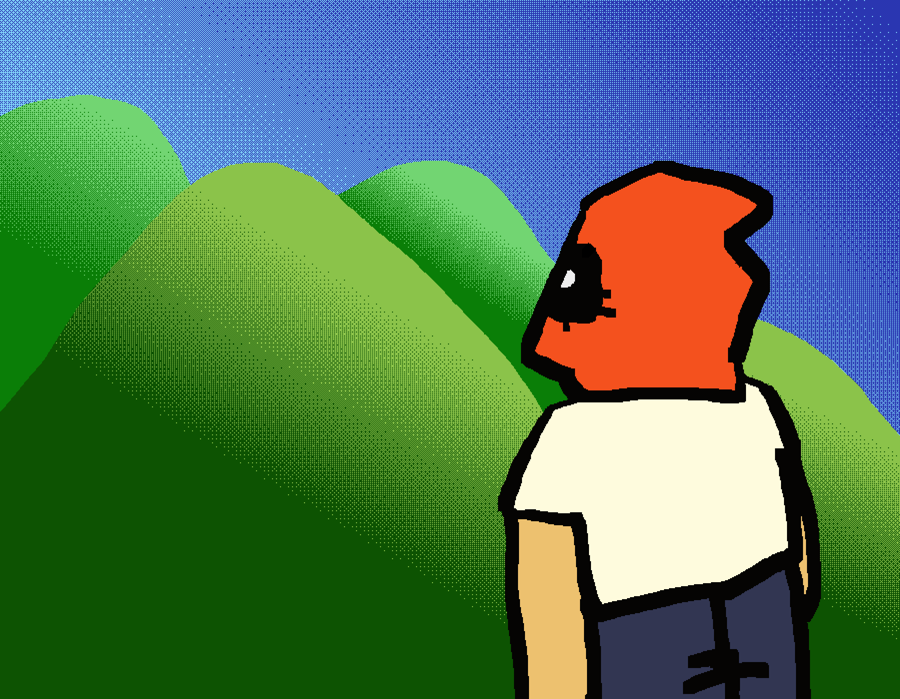

IT person, mainly building games/mods and Edu-tech software. I also do visual arts and localization. Based in Finland.

    

- **[ReadingDiplomaWebGame_Capstone1](https://github.com/AIMlearningProject/reading-diploma-web-game)** A web app that gamifies a school reading diploma to get kids read more books. Started in a small team and now the 1 dev. Funded by AIMlearning project (1.2.2024 to 30.4.2027) and Ylivieska City Library. 
- **[HiddenStoriesofKokkola-Demo](https://github.com/Osoito/HiddenStoriesofKokkola-Demo)** A Unity mobile game that encourages visitors to explore the city by scanning the QR codes to unlock stories. Idea from Kokkola City. Made in a small team with ANSEL.
- **[Nova_App](https://github.com/blankoner/Nova_App)** A career guidance web app for young people. An AI interviewer builds a skill profile and matches it against LinkedIn job offers, with skill mini-games and study tools on the side. I was in frontend team. International team of five, in an Erasmus+ programme at ISPGAYA in Porto.
- **Solar Neighborhood Simulator** A simulator that shows what a neighborhood gains when houses share solar energy, month by month in kWh and euros. I designed the React frontend architecture and developed and optimised the interactive neighborhood map. Made in an international team in an Erasmus+ programme at h_da in Darmstadt. The code is in a private repository for now.

- **[yukkuri-toolbar-presets](https://github.com/Osoito/yukkuri-toolbar-presets)** A hotkey mod for the Japanese game *Yukkuri Hakkei* (ゆっくり八景). The game has no mod support, so the mod reads the game's memory to save and switch toolbar layouts. Written in C.
- **[isaac-voice-sfx-pipeline](https://github.com/Osoito/isaac-voice-sfx-pipeline)** A sound effect mod for *The Binding of Isaac: Repentance+*. It replaces 673 sound effects with short pieces cut from 43 voice clips of one character. Available on the [Steam Workshop](https://steamcommunity.com/sharedfiles/filedetails/?id=3798883789).
- **[isaac-chiikawa-soundtrack](https://github.com/Osoito/isaac-chiikawa-soundtrack)** A Chiikawa music mod for *The Binding of Isaac: Repentance+*. It uses 16 tracks to cover all 85 music slots in the game. Available on the [Steam Workshop](https://steamcommunity.com/sharedfiles/filedetails/?id=3787641648).
- **[slot-assignment-scaffold](https://github.com/Osoito/slot-assignment-scaffold)** A small Python scaffold I pulled out of the two Isaac mods. I use it when a few clips, images or lines of text have to be spread over many slots.

<!-- gallery:start -->
 
 
 
<!-- gallery:end -->
